# Бизнес-анализ процесса: B2B Рассылка КП на стеллаж ЧЗМ (Модель 16112.200)

## 📌 1. Обзор продукта и целевой аудитории

* **Продукт:** Электромеханический стеллаж для листового металла 6000×2000 мм с выдвижными платформами.
* **Производитель:** ООО «Чайковский завод «Механика» (ЧЗМ), сайт [mehan59.ru](https://mehan59.ru).
* **Модель:** 16112.200 (базовая комплектация: 5 выдвижных платформ, до 5 000 кг на ярус, суммарная грузоподъемность до 25 000 кг, 100% электромеханический выкат).
* **Базовая стоимость:** 3 850 000 ₽ с НДС.
* **Материалы рассылки:** Коммерческое предложение с фото [[КП_ЧЗМ_стеллаж_для_предприятий_с_фото.pdf](file:///home/segun/CascadeProjects/%D0%A0%D0%B0%D1%81%D1%88%D0%B8%D1%80%D0%B5%D0%BD%D0%B8%D0%B5%20%D0%B4%D0%BB%D1%8F%20%D0%AE%D1%80%D0%B8%D1%8F/%D0%9A%D0%9F_%D0%A7%D0%97%D0%9C_%D1%81%D1%82%D0%B5%D0%BB%D0%BB%D0%B0%D0%B6_%D0%B4%D0%BB%D1%8F_%D0%BF%D1%80%D0%B5%D0%B4%D0%BF%D1%80%D0%B8%D1%8F%D1%82%D0%B8%D0%B9_%D1%81_%D1%84%D0%BE%D1%82%D0%BE.pdf)] и видео работы на Rutube.
* **Целевая аудитория:** Машиностроительные и металлообрабатывающие предприятия Москвы/МО и Санкт-Петербурга/ЛО с парком лазерной/плазменной резки.
* **Целевые ЛПР:** Главный инженер, начальник производства, начальник заготовительного участка, директор по закупкам.

---

## 🗺️ Архитектурная схема процесса (Draw.io)

Полная графическая схема всех этапов создана в формате XML Draw.io:
👉 **[b2b_mailing_workflow.drawio](file:///home/segun/CascadeProjects/%D0%A0%D0%B0%D1%81%D1%88%D0%B8%D1%80%D0%B5%D0%BD%D0%B8%D0%B5%20%D0%B4%D0%BB%D1%8F%20%D0%AE%D1%80%D0%B8%D1%8F/b2b_mailing_workflow.drawio)**

---

## 📊 Блок-схема взаимодействия 4 этапов

```mermaid
flowchart TD
    subgraph S1["1. СБОР И АИ-ВАЛИДАЦИЯ БАЗЫ"]
        A1["1.1 Открытый сбор без платных аккаунтов<br/>(Заводы.рф, Metaprom, ЕГРЮЛ, crawler)"]
        A2["1.2 Синтаксическая очистка RFC 5322<br/>(Trim, lowercase, удаление дублей)"]
        A3["1.3 Пакетная проверка DNS MX<br/>(Прямой опрос почтовых шлюзов)"]
        A4["1.4 AI-скоринг ICP и болей цеха (Qwen 2.5)<br/>(Рейтинг 90–98%, выявление болей)"]
        A5["1.5 Сегментация базы<br/>(Сегмент А: Москва/МО, Сегмент B: СПб/ЛО)"]
        A1 --> A2 --> A3 --> A4 --> A5
    end

    subgraph S2["2. ДВИЖОК ПОДГОТОВКИ ПИСЕМ И TOUCHPOINTS"]
        B1["2.1 Персонализация письма<br/>({Компания}, {ЛПР}, боль участка)"]
        B2["2.2 Вложение материалов<br/>(2 PDF до 2 МБ + видео Rutube)"]
        B3["2.3 AI-генератор цепочки 5 касаний<br/>(День 0, День 3-5, 7-10, 14, 21)"]
        B1 --> B2 --> B3
    end

    subgraph S3["3. ДИСПЕТЧЕР РАССЫЛКИ (ЯНДЕКС 360)"]
        C1["3.1 Защищенный шлюз SMTP<br/>(smtp.ya.ru:465, SSL/TLS)"]
        C2["3.2 Антиспам Rate Limiter<br/>(Паузы 35 сек между письмами)"]
        C3["3.3 Контроль копий (BCC)<br/>(pdu@mehan59.ru, mahovik@mail.ru)"]
        C4["3.4 Логирование в dispatch_log.json<br/>(Message-ID, 250 OK)"]
        C1 --> C2 --> C3 --> C4
    end

    subgraph S4["4. CRM-ВОРОНКА И AI-СУПЕРВИЗОР"]
        D1["4.1 Накопление базы (весь охват)<br/>(30 заводов: Партия 1 + Партия 2)"]
        D2["4.2 Пагинация по 15 заводов<br/>(Кнопка «Далее (след. 15 заводов)»)"]
        D3["4.3 Календарное движение по стадиям<br/>(Вкладка 1: 15 зав., Вкладка 2: 14 зав.)"]
        D4["4.4 Фиксация лидов (leads.json)<br/>(Росатом Элемаш: Запрос бланка ТКП ⚡)"]
        D5["4.5 AI-Супервизор воронки (Qwen 2.5)<br/>(Авто-диагностика и аудит сделок)"]
        D1 --> D2 --> D3 --> D4 --> D5
    end

    A5 == "Готовая выборка" ==> B1
    B3 == "Очередь на отправку" ==> C1
    C4 == "Фиксация статусов" ==> D1
```

---

## 📈 4. Контроль KPI и текущие результаты кампании

| Показатель | Норматив по ТЗ | Фактический результат кампании |
|---|:---:|:---:|
| **Доставляемость (Delivery Rate)** | ≥ 95% | **100% (30 из 30 писем доставлены, SMTP 250 OK)** |
| **Ошибки и спам-блокировки** | ≤ 5% | **0% (блокировок нет)** |
| **Отклик целевых предприятий** | ≥ 1–2% | **3.3% (Зафиксирован ответ от ТВЭЛ Росатом)** |
| **Качество базы (DNS MX)** | 100% активных | **30/30 корпоративных шлюзов подтверждены** |
| **Сумма воронки в CRM** | — | **115.5 млн ₽ (30 предприятий × 3.85 млн ₽)** |

---

## 🏢 5. Статус предприятий в CRM на 18.10.2026

1. **Вкладка 1 (Этап 1: День 0–2)**:
   - **15 заводов** из Партии 2, успешно отправленные 18.10 в 16:51–16:59:
     - АО «ДМЗ им. Федорова» (Дубна)
     - АО «Силовые машины» (СПб)
     - АО «Коломенский завод» (Коломна)
     - АО «Балтийский завод» (СПб)
     - АО «Мытищинский машиностроительный завод» (Мытищи)
     - АО «ГОЗ Обуховский завод» (СПб)
     - ПАО «Криогенмаш» (Балашиха)
     - АО «СНСЗ» (СПб)
     - АО «ЭЗТМ» (Электросталь)
     - ПАО «Ижорские заводы» (СПб)
     - и другие.

2. **Вкладка 2 (Этап 2: День 3–5)**:
   - **14 заводов** из Партии 1 (отправлены 14.10, прошло 4 дня):
     - Находятся на стадии подготовки Follow-up №1 (*«Экономия 70% площади цеха»*).

3. **Вкладка 4 (Этап 4: Лиды ⚡)**:
   - **1 завод**: **АО «Машиностроительный завод» (МСЗ «Элемаш», ТВЭЛ Росатом, Электросталь)**.
   - *Результат диалога*: получено официальное требование от заводоуправления: *«В работу принимаются официальные письма: номер, дата, подпись»*.
   - *Действие*: подготовлен официальный бланк ТКП на модель 16112.200 (стоимость 3 850 000 ₽).
