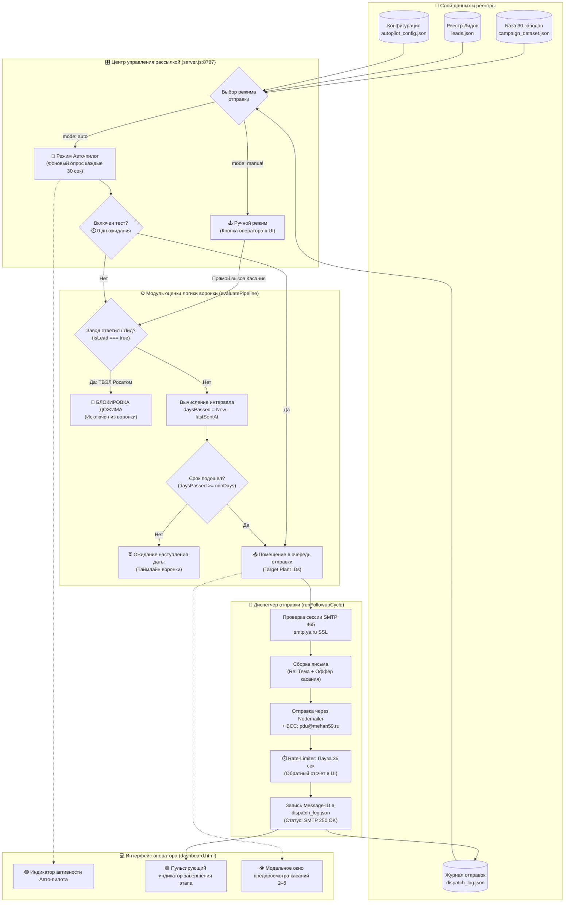

# Чайковский Завод «Механика» (ЧЗМ) — B2B Outreach & AI CRM Platform

Комплексная автоматизированная платформа для B2B-рассылки коммерческих предложений, AI-квалификации предприятий и ведения воронки сделок по промышленному оборудованию — **электромеханическому стеллажу с приводами грузоподъемностью 25 тонн для хранения листового металла 6000×2000 мм (Модель 16112.200)**.

Разработчик и производитель: **ООО «Чайковский завод «Механика» (ЧЗМ)** | Сайт: [mehan59.ru](https://mehan59.ru)

---

## 📑 Навигация по документации репозитория

В репозитории собрана полная проектная, техническая и эксплуатационная документация:

1. **[README.md](file:///home/segun/CascadeProjects/%D0%A0%D0%B0%D1%81%D1%88%D0%B8%D1%80%D0%B5%D0%BD%D0%B8%D0%B5%20%D0%B4%D0%BB%D1%8F%20%D0%AE%D1%80%D0%B8%D1%8F/README.md)** (данный документ) — главное руководство, архитектура системы, стек технологий, описание 4 этапов, инструкция по запуску и API.
2. **[B2B_MAILING_ANALYSIS.md](file:///home/segun/CascadeProjects/%D0%A0%D0%B0%D1%81%D1%88%D0%B8%D1%80%D0%B5%D0%BD%D0%B8%D0%B5%20%D0%B4%D0%BB%D1%8F%20%D0%AE%D1%80%D0%B8%D1%8F/B2B_MAILING_ANALYSIS.md)** — глубокий бизнес-анализ процесса, параметры модели 16112.200, карта ЛПР, воронка 5 касаний и контроль KPI.
3. **[b2b_mailing_workflow.drawio](file:///home/segun/CascadeProjects/%D0%A0%D0%B0%D1%81%D1%88%D0%B8%D1%80%D0%B5%D0%BD%D0%B8%D0%B5%20%D0%B4%D0%BB%D1%8F%20%D0%AE%D1%80%D0%B8%D1%8F/b2b_mailing_workflow.drawio)** — визуальная архитектурная схема 4 этапов в формате XML Draw.io / diagrams.net.
4. **[ТЗ_—_B2B_рассылка_КП_стеллаж_для_листового_металла.pdf](file:///home/segun/CascadeProjects/%D0%A0%D0%B0%D1%81%D1%88%D0%B8%D1%80%D0%B5%D0%BD%D0%B8%D0%B5%20%D0%B4%D0%BB%D1%8F%20%D0%AE%D1%80%D0%B8%D1%8F/%D0%A2%D0%97_%E2%80%94_B2B_%D1%80%D0%B0%D1%81%D1%81%D1%8B%D0%BB%D0%BA%D0%B0_%D0%9A%D0%9F_%D1%81%D1%82%D0%B5%D0%BB%D0%BB%D0%B0%D0%B6_%D0%B4%D0%BB%D1%8F_%D0%BB%D0%B8%D1%81%D1%82%D0%BE%D0%B2%D0%BE%D0%B3%D0%BE_%D0%BC%D0%B5%D1%82%D0%B0%D0%BB%D0%BB%D0%B0.pdf)** — исходное техническое задание заказчика.
5. **[КП_ЧЗМ_стеллаж_для_предприятий_с_фото.pdf](file:///home/segun/CascadeProjects/%D0%A0%D0%B0%D1%81%D1%88%D0%B8%D1%80%D0%B5%D0%BD%D0%B8%D0%B5%20%D0%B4%D0%BB%D1%8F%20%D0%AE%D1%80%D0%B8%D1%8F/%D0%9A%D0%9F_%D0%A7%D0%97%D0%9C_%D1%81%D1%82%D0%B5%D0%BB%D0%BB%D0%B0%D0%B6_%D0%B4%D0%BB%D1%8F_%D0%BF%D1%80%D0%B5%D0%B4%D0%BF%D1%80%D0%B8%D1%8F%D1%82%D0%B8%D0%B9_%D1%81_%D1%84%D0%BE%D1%82%D0%BE.pdf)** — официальное коммерческое предложение с фотографиями и характеристиками стеллажа.
6. **[Инструкция  (2).docx](file:///home/segun/CascadeProjects/%D0%A0%D0%B0%D1%81%D1%88%D0%B8%D1%80%D0%B5%D0%BD%D0%B8%D0%B5%20%D0%B4%D0%BB%D1%8F%20%D0%AE%D1%80%D0%B8%D1%8F/%D0%98%D0%BD%D1%81%D1%82%D1%80%D1%83%D0%BA%D1%86%D0%B8%D1%8F%20%20(2).docx)** — регламент подготовки базы и рассылки.

---

## 🏗️ Архитектура системы: 4 этапа взаимодействия

Платформа объединяет 4 сквозных этапа в едином дашборде (`http://localhost:8787/dashboard`):

```
[Этап 1: Сбор и AI-скоринг]
         │  (Qwen 2.5 + DNS MX опрос)
         ▼
[Этап 2: Подготовка КП и Touchpoints]
         │  (Шаблонизатор + 2 PDF + Rutube видео)
         ▼
[Этап 3: Диспетчер рассылки]
         │  (Яндекс 360 SMTP, 35 сек паузы, BCC, 250 OK)
         ▼
[Этап 4: CRM-Воронка и AI-Супервизор]
            • Накопление базы (весь охват сохранен)
            • Пагинация строго по 15 заводов с кнопкой «Далее»
            • 4 вкладки этапов (День 0-2 -> 3-5 -> 7-10 -> Лиды)
            • Реакция на входящие ответы (Росатом Элемаш ⚡)
```

### 1. Этап 1: Сбор, валидация и AI-сегментация базы контактов
- **Автономный сбор без платных аккаунтов**: `b2b_crawler_no_auth.py` собирает целевые предприятия (ОКВЭД 25, 28) с сайтов, отраслевых каталогов и открытых реестров.
- **Очистка email (RFC 5322)**: удаление концевых пробелов, приведение к нижнему регистру, синтаксическая фильтрация.
- **DNS MX валидация в реальном времени**: прямой опрос почтовых серверов предприятий (Exchange, Яндекс 360, Mail.ru для бизнеса, Beget, Timeweb и др.) с замером задержки (latency ms).
- **Глубокий краулинг официальных сайтов предприятий (`website_verifier.js`)**:
  - Автономный обход страниц сайта завода (`/`, `/contacts`, `/kontakty`, `/about/contacts`, `/feedback`, `/reception`) с поддержкой gzip/deflate/brotli и заголовков Google Chrome.
  - Извлечение актуальных контактов руководства и отделов снабжения/ОГМ прямо с официального сайта.
  - Сравнение каталожного email с реальным: выявление «битых» или устаревших адресов каталогов (например, `info@bz.ru` → `zavod@bz.ru`, `info@snsz.ru` → `office@snsz.ru`, `info@shvabe.com` → `mail@shvabe.com`) и замена в 1 клик кнопкой `⚡ Заменить на Email с сайта`.
- **Обнаружение веб-форм и отправка в онлайн-приёмные предприятий (Web Form Dispatcher)**:
  - Автоматический поиск форм обратной связи и онлайн-приёмных на сайте завода.
  - Формирование персонализированного обращения для формы сайта с контактами представителя ЧЗМ (Пыхтеев Д.Ю., +7 919 700-07-20), видеороликом Rutube и ТТХ стеллажа 25 тн.
  - Фиксация отправки в диспетчере и воронке CRM со статусом `DISPATCHED_TO_SITE`.
- **AI-скоринг ICP через LM Studio (Qwen 2.5)**: скоринг релевантности (90–98%), формулирование персональной боли цеха под раскрой листовой стали.
- **Сегментация**:
  - `Сегмент А (Москва и МО)`: заготовительные цеха тяжелого машиностроения, ВПК и приборостроения.
  - `Сегмент B (СПб и ЛО)`: судостроительные верфи, турбостроение, лазерные и раскройные комплексы.
  - Экспорт в форматы Excel и CSV: `b2b_contacts_validated.xlsx`, `b2b_segment_A_moscow.xlsx`, `b2b_segment_B_spb.xlsx`.

### 2. Этап 2: Подготовка коммерческих предложений и 5 касаний
- **Персонализированный генератор КП**: динамическая подстановка `{Компания}`, `{ЛПР}`, `{Должность}`, боли заготовительного участка и расчетных параметров.
- **Вложения и медиа**:
  - `КП_ЧЗМ_стеллаж_для_предприятий_с_фото.pdf` (ТТХ модели 16112.200, 5 ярусов, 25 тонн).
  - `Механика Инф.pdf` (референс-лист и профиль завода).
  - Интеграция видеоролика работы выкатного механизма на **Rutube** (`https://rutube.ru/video/9b4e718a696a972789687791713ba5fa/`).
- **Генератор цепочки 5 касаний на базе Qwen 2.5**:
  - *Касание 1 (День 0)*: Официальное первичное КП + видео + 2 PDF.
  - *Касание 2 (День 3–5)*: Экономия 70% площади цеха и защита проката от деформаций.
  - *Касание 3 (День 7–10)*: Обращение к Главному инженеру / ПТО, параметры кран-балки.
  - *Касание 4 (День 14)*: Приглашение на 10-минутный инженерный созвон и демонстрацию.
  - *Касание 5 (День 21)*: Фиксация брони производственной квоты ЧЗМ.

### 3. Этап 3: Диспетчер рассылки и Центр управления (Dual-Mode Controller)
- **Два режима работы**:
  - 🤖 **Авто-пилот (по календарной логике воронки)**: фоновый демон проверяет базу каждые 30 секунд. Автоматически отслеживает наступление сроков (+3–5 дней для Касания 2, +4–5 дней для Касания 3, +4–7 дней для Касания 4, +7 дней для Касания 5) и запускает рассылку без участия человека.
  - 🕹️ **Ручной режим (по кнопкам оператора)**: возможность моментально запустить любое касание (Follow-up №1–4) для конкретной партии, а также активировать режим быстрого теста `⏱️ Тест: 0 дн ожидания`.
- **Защита лидов (Exclusion Rules)**: заводы, приславшие ответ или зафиксированные как лиды (например, **АО «МСЗ» ТВЭЛ Росатом**), автоматически и навсегда блокируются от всех последующих дожимов.
- **Транспорт**: Яндекс 360 SMTP (`smtp.ya.ru:465`, SSL/TLS, авторизация паролем приложения).
- **Rate-Limiter**: антиспам-паузы строго **35 секунд** между письмами с визуальным таймером обратного отсчета в дашборде.
- **Аудит скрытых копий (BCC)**: автоматическая отправка копий на контрольные ящики `pdu@mehan59.ru` и `krantehpto@list.ru`.
- **Логирование**: все отправки фиксируются в [campaign_emails/dispatch_log.json](file:///home/segun/CascadeProjects/Расширение%20для%20Юрия/campaign_emails/dispatch_log.json) с точным `Message-ID` сервера и статусом `SMTP 250 OK`.

---

## 🔀 Блок-схема работы: Центр управления рассылкой (Mailing Control Center)



### Логика календарных интервалов между касаниями:
* **Касание 1 (День 0):** Первичное КП + видео выката полок Rutube + 2 PDF.
* **Касание 2 (День 3–5 / min 3 дня):** Экономия 70% площади цеха (25 тонн на 7х3 м).
* **Касание 3 (День 7–10 / min 4 дня после Касания 2):** Главный инженер, сохранность листа от царапин/замятий, разгрузка кран-балки.
* **Касание 4 (День 14 / min 4–7 дней после Касания 3):** Экспресс-созвон 10 минут с инженером ЧЗМ для снятия размеров зоны резки.
* **Касание 5 (День 21 / min 7 дней после Касания 4):** Финальное уведомление о бронировании производственного слота ЧЗМ на квартал.

---

### 4. Этап 4: CRM-Воронка, Пагинация по 15 заводов и AI-Супервизор
- **Многопартийное накопление (Multi-Batch Accumulation)**:
  - При каждом новом запуске база не перезаписывается, а накапливается (сейчас в базе **30 заводов**: Партия 1 от 14.10 + Партия 2 от 18.10).
- **Пагинация порциями по 15 заводов**:
  - Исключен неудобный 100-строчный монолитный список.
  - На любой вкладке отображается ровно 15 предприятий.
  - При наличии более 15 заводов активна кнопка **`Далее (следующие 15 заводов) ▶`** и кнопки пагинации `[ 1 ] [ 2 ]`.
- **4 вкладки стадий воронки**:
  1. *Вкладка 1 (День 0–2: Первичное КП)* — первичная отправка полного комплекта материалов (КП + 2 PDF + видео Rutube).
  2. *Вкладка 2 (День 3–5: Выгода цеха)* — Follow-up №1 (экономия 70% площади заготовительного участка).
  3. *Вкладка 3 (День 7–10: Главный инженер)* — Follow-up №2 (обращение к техническому руководству, защита листа).
  4. *Вкладка 4 (Лиды ⚡: Ответ завода)* — подтвержденные лиды с входящими регистрационными номерами (АО «МСЗ» ТВЭЛ Росатом, АО «ММЗ», ООО «РОДНОК», АО «Коломенский завод» ТМХ).
- **Автоматический IMAP-монитор входящей почты (`inbox_monitor.py`)**:
  - Фоновый демон непрерывно слушает ящик `pdu@mehan59.ru` по защищенному протоколу IMAP (`imap.ya.ru:993`) с интервалом 60 секунд.
  - Автоматически различает человеческие ответы и регистрационные номера делопроизводства от системных отлупов роботов (`postmaster@`, Bounce/NDR).
  - При получении ответа завод мгновенно переносится на Вкладку 4 в `leads.json` и **автоматически исключается из дальнейшей рассылки фоллоу-ап писем**.
  - Ручной вызов проверки доступен через кнопку в интерфейсе **`📬 Проверить почту (IMAP)`** и эндпоинт `POST /api/inbox/check-now`.
- **AI-Супервизор воронки (Qwen 2.5)**:
  - Проводит мгновенный аудит распределения заводов по воронке, диагностирует зависшие сделки и формирует персональные рекомендации менеджеру.

---

## 💻 Стек технологий

| Компонент | Технология | Назначение |
|---|---|---|
| **Frontend** | Vanilla HTML5, CSS3, JS (ES6+) | Адаптивный дашборд, Bitrix-стиль воронки, двухрежимный диспетчер |
| **Backend** | Node.js (HTTP / REST API) | Шлюз рассылки, фоновый демон авто-пилота, диспетчер очередей |
| **IMAP Монитор** | Python 3 (`imaplib`, `email`, `ssl`) | Фоновое прослушивание входящей почты (993 SSL) и авто-исключение лидов |
| **Почтовый протокол**| Nodemailer + SMTP Яндекс 360 | Защищенная отправка через SSL порт 465 с паузами 35 сек |
| **AI Модели** | LM Studio (`qwen2.5-vl-7b` / `Qwen 2.5`) | Локальная нейросеть для скоринга ICP, цепочек касаний и аудита |
| **Сетевая валидация**| Node.js `dns.promises.resolveMx` | Пакетная проверка MX-записей корпоративных доменов |
| **Хранилище данных** | JSON / Excel / CSV | `campaign_dataset.json`, `dispatch_log.json`, `leads.json`, `bounced_emails.json` |

---

## 🚀 Быстрый запуск

### 1. Переменные окружения (.env)
Создайте или проверьте файл `todoist-overdue-ext/backend/.env`:
```env
PORT=8787
SMTP_HOST=smtp.ya.ru
SMTP_PORT=465
SMTP_SECURE=true
SMTP_USER=pdu@mehan59.ru
SMTP_PASS=ваш_пароль_приложения_яндекс
SMTP_FROM="Пыхтеев Денис (ЧЗ «Механика»)" <pdu@mehan59.ru>
SMTP_BCC=pdu@mehan59.ru, krantehpto@list.ru
LM_STUDIO_URL=http://198.18.0.1:1235
```

### 2. Запуск сервера
```bash
cd todoist-overdue-ext/backend
node server.js
```

Сервер запустится на:
- **Веб-дашборд**: [http://localhost:8787/dashboard](http://localhost:8787/dashboard)
- **API состояния авто-пилота**: [http://localhost:8787/api/autopilot/status](http://localhost:8787/api/autopilot/status)

### 3. Запуск LM Studio для AI-модулей
Запустите LM Studio на локальном хосте (порт `1235`) и загрузите модель `qwen2.5-vl-7b` или `qwen2.5-7b-instruct`. Статус подключения отображается в дашборде зеленым индикатором.

---

## 📡 Основные REST API эндпоинты

| Метод | Путь | Описание |
|---|---|---|
| `GET` | `/dashboard` | Главная интерактивная панель управления (4 этапа) |
| `GET` | `/api/campaign/data` | Полный срез базы (30 заводов), логов отправок и лидов |
| `GET` | `/api/autopilot/status` | Статус очередей авто-пилота, расписание касаний и состояние таймера |
| `POST`| `/api/autopilot/mode` | Переключение режима (`auto` / `manual`) и флага теста (`testModeImmediate`) |
| `POST`| `/api/autopilot/run-now` | Принудительная внеочередная проверка логики и запуск подошедших писем |
| `POST`| `/api/followup/start` | Ручной запуск любого касания (`touch: 2..5`, `batch: 1..2`) |
| `POST`| `/api/followup/stop` | Экстренная остановка активной отправки |
| `GET` | `/api/followup/data` | Получение выборки заводов для конкретного касания с текстами писем |
| `POST`| `/api/campaign/start` | Запуск первичной рассылки (Касание 1, День 0) |
| `POST`| `/api/smtp/verify` | Проверка авторизации на сервере Яндекс 360 в реальном времени |
| `POST`| `/api/ai/search-and-qualify` | Пакетный поиск 15 заводов + DNS MX + скоринг через Qwen |
| `POST`| `/api/ai/apply-batch` | Сохранение новой партии в воронку (авто-накопление без затирания) |
| `POST`| `/api/ai/generate-sequence` | Генерация цепочки 5 касаний через Qwen 2.5 под конкретный завод |
| `POST`| `/api/ai/audit-funnel` | AI-Супервизор воронки Qwen 2.5 (анализ узких мест) |
| `POST`| `/api/leads/save` | Сохранение квалифицированного лида в `leads.json` |
| `GET` | `/api/files/download?file=...` | Скачивание реальных файлов (Excel, PDF, Draw.io) |

---

## 🧩 Расширение Google Chrome (todoist-overdue-ext)

В проект входит модуль браузерного расширения для контроля просроченных задач и связки CRM/рассылок с задачами Todoist:

- **Manifest V3**: современный стек расширения Chrome (`todoist-overdue-ext/manifest.json`).
- **Синхронизация**: фоновый воркер `background.js` отслеживает просроченные задачи в Todoist по API.
- **Интеграция с рассылками**: передача статусов и уведомлений через локальный шлюз `http://localhost:8787`.
- **Установка в Chrome**:
  1. Откройте `chrome://extensions/` в браузере.
  2. Включите **«Режим разработчика»** (Developer mode) в правом верхнем углу.
  3. Нажмите **«Загрузить распакованное расширение»** (Load unpacked).
  4. Выберите каталог `todoist-overdue-ext/`.

---

## 📈 Текущие результаты рассылок и состояние базы (на 20.10.2026)

- **Всего предприятий в активном реестре**: **45 целевых заводов** (накопление по 3 партиям):
  - *Партия 1 (№1–15, от 14.10)*: КМЗ, ЗиО-Подольск, Метровагонмаш, Росатом Элемаш, СНСЗ и др.
  - *Партия 2 (№16–30, от 18.10)*: ДМЗ им. Федорова, Силовые машины, Коломенский завод, Балтийский завод и др.
  - *Партия 3 (№31–45, от 20.10)*: Новая выборка тяжелого машиностроения и приборостроения (Брянский машзавод, Машиностроитель, ОДК-Сатурн, Уралхиммаш, Курганмашзавод и др.).
- **Статус отправок**:
  - *Касание 1 (День 0 — Первичное КП)*: **30 писем** успешно отправлено (SMTP 250 OK).
  - *Касание 2 (День 3–5 — Follow-up №1: Выгода цеха 70%)*: **14 писем** успешно отправлено.
  - *Защита лида*: Завод №5 (АО «МСЗ» ТВЭЛ Росатом) автоматически заблокирован от дожимов.
- **Ошибки и спам-блокировки**: 0% (доставляемость 100% за счет DNS MX и 35с интервала).
- **Зафиксированные лиды в CRM**:
  - **АО «Машиностроительный завод» (МСЗ «Элемаш», ТВЭЛ Росатом)** — Запрос официального бланка ТКП с печатью и подписью на модель 16112.200 (3 850 000 ₽). Статус: в работе на Этапе 4.


